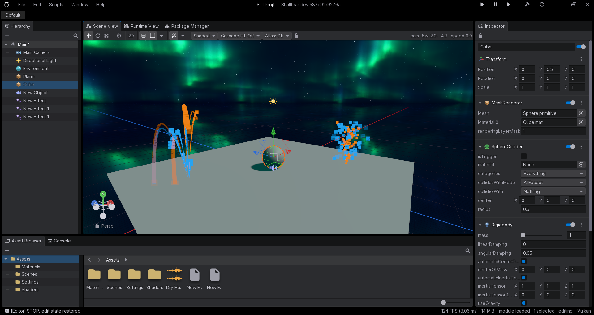

# Shalltear

[](https://github.com/mewiof/Shalltear/stargazers)
[](https://ko-fi.com/mewiof)

A C++ game engine.

It's in active development. No releases yet, things may (!) change and break.

[Download](https://shalltear.dev/download) · [Discord](https://discord.gg/tYFstqd7jE)



## Features

- Editor with a scene view/hierarchy/inspector/asset browser/console/profiler/etc.
- C++ scripting with hot reload + play mode
- Vulkan 1.3 renderer with HLSL shaders, post-processing + node-based shader editor
- GPU particle effects (also built from nodes)
- 3D physics, skeletal animation, audio
- glTF/FBX import
- UI toolkit with layout, styling/docking + visual UI builder
- Building pipeline (building a standalone game from your project)

## Requirements

- Windows 10 or 11, 64-bit
- A GPU with Vulkan 1.3 drivers
- [Git](https://git-scm.com/download/win)
- [Python 3](https://www.python.org/downloads/) (tick _**Add python.exe to PATH**_ in the installer)
- ~6 GB of free disk space

Visual Studio is not required. The engine builds with Clang only + automatically downloads a copy of Clang/CMake/Ninja.

## Building

```bat
git clone --recursive https://github.com/mewiof/Shalltear.git
cd Shalltear
Build.bat
```

The first run downloads the toolchain and compiles everything (so it takes a while). Run `Build.bat` again after every `git pull`.

Then start the editor:

```bat
Build.bat run
```

### Build.bat commands

| Command | Purpose |
| --- | --- |
| `Build.bat` | Builds the editor (Debug) in `build\` |
| `Build.bat run` | Starts the editor you built |
| `Build.bat tests` | Builds, then runs the test suite |
| `Build.bat sdk` | Packages the SDK into `ShalltearSDK\` (Release, shared/static) |
| `Build.bat shell` | Opens a command prompt with the pinned toolchain on `PATH` |
| `Build.bat clean` | Deletes `build\` |

## VS Code

Open the folder. If you see the blue bar at the top saying "Restricted Mode...", click "Manage", then "Trust". Accept the recommended extensions. `CMakePresets.json` and `.vscode\` are ready, so pick the **Debug (shared)** preset when CMake Tools asks. Don't select a kit. Reload the window once after the first "configure" (so clangd picks up the right compiler).

TODO: CMake Tools 1.23 (and newer) can freeze VS Code for a while after a configure. Install 1.22.28 until that's fixed (sent a pull request https://github.com/microsoft/vscode-cmake-tools/pull/5101):

```bat
code --install-extension ms-vscode.cmake-tools@1.22.28
```

Builds go A LOT faster with Windows Defender configured to skip the checkout. In an elevated PowerShell:

```powershell
Add-MpPreference -ExclusionPath "C:\path\to\Shalltear"
Add-MpPreference -ExclusionProcess clang++.exe,clang.exe,ninja.exe,lld.exe,ld.lld.exe
```

## Contributing

Pull requests aren't open yet. Bug reports and ideas are very welcome on [Discord](https://discord.gg/tYFstqd7jE)! ;)

## License

MIT, see [LICENSE.txt](LICENSE.txt). Third-party code and assets keep their licenses, listed in [THIRD-PARTY-NOTICES.txt](THIRD-PARTY-NOTICES.txt).
